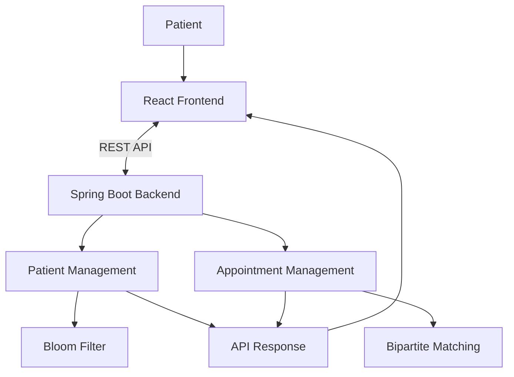

# MediSlot
### Smart Healthcare Appointment Scheduling System

MediSlot is a web-based healthcare appointment scheduling application that simplifies doctor discovery, appointment booking, and patient appointment management. It combines modern web technologies with advanced algorithms to improve appointment allocation and data processing.

---

## 1. Technology Stack

| Category | Technology | Purpose |
|---|---|---|
| Frontend |  | User interface development |
| Frontend Tool |  | Frontend development and build |
| Programming Language |  | Backend development |
| Backend Framework |  | REST API development |
| Build Tool |  | Dependency management and builds |
| Testing |  | Unit testing |
| Version Control |  | Source code management |
| Repository Hosting |  | Project collaboration and hosting |

---

## 2. Project Overview

MediSlot provides a centralized platform where patients can:

- Register and manage their information.
- Browse doctors by specialization.
- Book appointments.
- View appointment history.
- Cancel confirmed appointments.

The project also demonstrates the practical implementation of advanced algorithms for appointment allocation and preliminary email membership screening.

## 3. Key Features

| Feature | Description |
|---|---|
| Patient Registration | Allows new patients to register with their information. |
| Doctor Listing | Displays available doctors and their specializations. |
| Appointment Booking | Enables patients to book appointments. |
| Appointment History | Displays previously booked appointments and their status. |
| Appointment Cancellation | Allows patients to cancel confirmed appointments. |
| Algorithmic Allocation | Uses Bipartite Matching to model appointment allocation. |
| Email Screening | Uses a Bloom Filter for preliminary email membership checks. |

## 4. System Architecture



The frontend communicates with the backend through REST APIs. The backend handles patient and appointment operations and applies the relevant algorithmic logic.

## 5. Advanced Algorithms

### 5.1 Bipartite Matching

The project implements a DFS-based augmenting path approach to find maximum matching between appointment requests and available slots.

| Property | Complexity |
|---|---|
| Time Complexity | O(V × E) |
| Space Complexity | O(V + E) |
| Technique | DFS-based Augmenting Paths |

**Purpose:** To find a maximum number of valid assignments while ensuring that a slot is not assigned to multiple requests.

### 5.2 Bloom Filter

A Bloom Filter is a probabilistic data structure used for preliminary email membership screening. It uses multiple hash functions and a BitSet to represent possible membership.

| Operation | Complexity |
|---|---|
| Insertion | O(k) |
| Lookup | O(k) |
| Space | O(m) bits |

**Important:** A Bloom Filter can produce false positives. Therefore, positive membership results are verified using an exact repository lookup.

## 6. Project Structure

```text
MediSlot/
│
├── backend/
│   ├── src/
│   │   ├── main/
│   │   └── test/
│   └── pom.xml
│
├── frontend/
│   ├── src/
│   └── package.json
│
├── docs/
│   └── Algorithm_Analysis.md
│
├── reports/
│   ├── Project_Proposal.md
│   ├── Technical_Project_Report.md
│   └── screenshots/
│
└── README.md
```

## 7. Installation and Setup

### Prerequisites

| Software | Requirement |
|---|---|
| Java | Version 17 or later |
| Maven | Installed and configured |
| Node.js | Installed |
| npm | Installed |
| Git | Installed |

### Clone the Repository

```bash
git clone https://github.com/SohaPatel/MediSlot.git
cd MediSlot
```

### Backend Setup

```bash
cd backend
mvn clean install
```

### Frontend Setup

Open a separate terminal:

```bash
cd frontend
npm install
```

## 8. Running the Application

The frontend and backend must run in separate terminals.

**Start the Backend:**

```bash
cd backend
mvn spring-boot:run
```

Backend URL: `http://localhost:8081`

**Start the Frontend:**

```bash
cd frontend
npm run dev
```

Frontend URL: `http://localhost:5173`

## 9. API Endpoints

| HTTP Method | Endpoint | Description |
|---|---|---|
| POST | `/api/patients/register` | Register a patient |
| GET | `/api/patients` | Retrieve patients |
| GET | `/api/appointments` | Retrieve appointments |
| GET | `/api/appointments/doctors` | Retrieve doctors |
| POST | `/api/appointments/book` | Book an appointment |
| GET | `/api/appointments/patient/{patientId}` | Retrieve patient appointment history |
| PATCH | `/api/appointments/{id}/cancel` | Cancel an appointment |

## 10. Testing

The backend uses JUnit for algorithm unit testing.

**Run the test suite:**

```bash
cd backend
mvn clean test
```

### Recorded Test Results

| Test Suite | Tests Passed | Failures | Errors |
|---|---:|---:|---:|
| Bipartite Matching | 8 | 0 | 0 |
| Bloom Filter | 8 | 0 | 0 |
| **Total** | **16** | **0** | **0** |

## 11. Performance Analysis

### 11.1 Bipartite Matching vs Greedy

| Input Size | Algorithm | Average Execution Time (ms) | Matched |
|---:|---|---:|---:|
| 100 | Bipartite Matching | 0.1132 | 100 |
| 100 | Greedy | 0.0325 | 96 |
| 300 | Bipartite Matching | 0.3307 | 300 |
| 300 | Greedy | 0.1425 | 280 |
| 600 | Bipartite Matching | 1.1118 | 600 |
| 600 | Greedy | 0.2541 | 564 |

**Observation:** Bipartite Matching achieved more matches in the recorded experiments, while Greedy had lower execution time.

### 11.2 Bloom Filter vs HashSet

| Input Size | Lookup Method | Average Execution Time (ms) |
|---:|---|---:|
| 1,000 | Bloom Filter + Exact Check | 0.9013 |
| 1,000 | Exact HashSet | 0.2003 |
| 5,000 | Bloom Filter + Exact Check | 2.9528 |
| 5,000 | Exact HashSet | 0.3812 |
| 10,000 | Bloom Filter + Exact Check | 6.0818 |
| 10,000 | Exact HashSet | 0.4993 |

**Observation:** Direct HashSet lookup was faster than Bloom Filter screening followed by an exact check in the recorded benchmark. Bloom Filters may be useful when they avoid more expensive external lookups.

*All benchmark results are specific to the local testing environment and workload.*

## 12. Future Enhancements

| Area | Proposed Enhancement |
|---|---|
| Database | Integration with persistent database storage |
| Security | Authentication and role-based authorization |
| Scheduling | Appointment rescheduling |
| Notifications | Email and SMS notifications |
| Availability | Improved doctor availability management |
| Deployment | Cloud-based deployment |

## 13. Team Contributions

| Team Member | Contributions |
|---|---|
| Soha Patel | Patient-facing frontend, appointment history, cancellation interface, Bloom Filter implementation and integration, algorithm analysis documentation |
| Tanishka Shukla | Bipartite Matching algorithm work, algorithm testing and benchmarking, Bloom Filter testing and benchmarking, technical documentation |

## 14. Project Documentation

| Document | Description |
|---|---|
| [Project Proposal](reports/Project_Proposal.md) | Project objectives, scope, and expected outcomes |
| [Technical Project Report](reports/Technical_Project_Report.md) | Technical implementation and project details |
| [Algorithm Analysis](docs/Algorithm_Analysis.md) | Algorithm complexity and performance analysis |
| [Screenshot Documentation](reports/screenshots/README.md) | Application and testing evidence |

---

<div align="center">

**MediSlot**

Smart Healthcare Appointment Scheduling System

Advanced Algorithm Project

</div>
